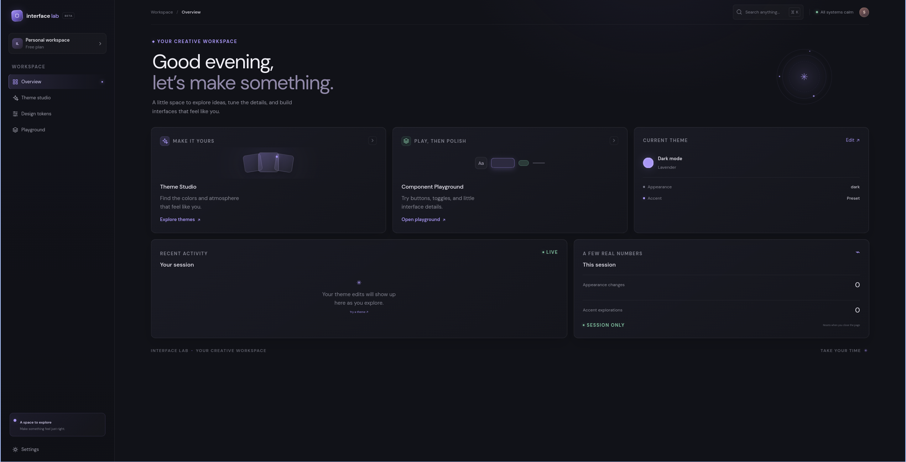
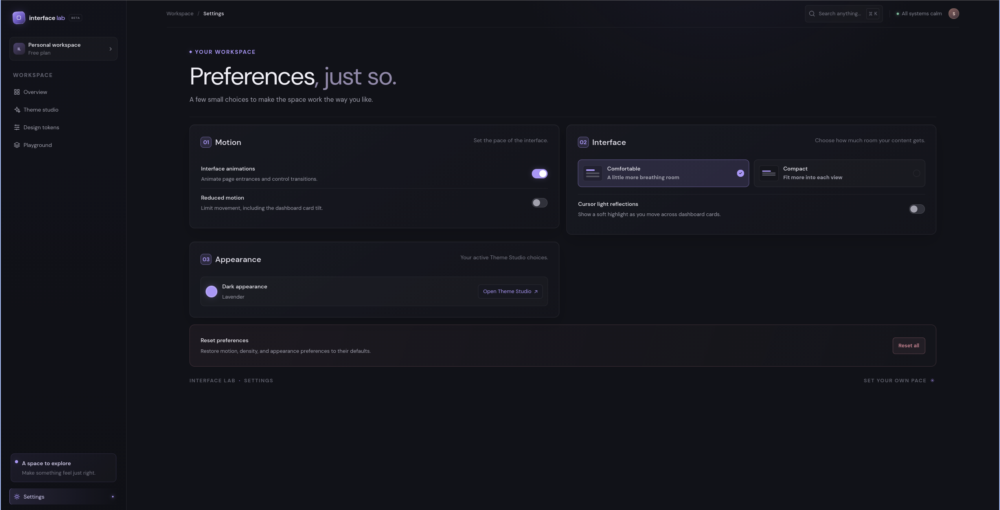

<div align="center">
  
  <h1>Interface Lab</h1>
  <p><strong>A considered space for shaping interfaces.</strong></p>
  <p>A desktop-first creative workspace for exploring themes, editing design tokens, and prototyping reusable UI components.</p>
  <p><code>React</code> · <code>TypeScript</code> · <code>Vite</code> · <code>CSS</code></p>
</div>

---

## In the workspace

Interface Lab brings a theme workbench, a design-token sandbox, and a component playground into one personal workspace. Tune the details, see changes in context, and keep useful experiments as presets. It is built for hands-on interface exploration and as an open-source frontend learning project.

## A look inside

QHD captures of the application in its dark appearance.

<table>
  <tr>
    <td width="50%"><strong>Overview</strong><br /></td>
    <td width="50%"><strong>Settings</strong><br /></td>
  </tr>
</table>

## What you can explore

### Theme and tokens

- **Theme Studio** switches between dark and light appearance and offers preset or custom accent colors.
- **Design Tokens** provides an isolated live preview for color, typography, spacing, shape, shadow, and effect tokens. Apply or discard drafts, restore defaults, save token presets, and export CSS variables or JSON.
- **Typography** includes searchable built-in fonts and browser-local custom font uploads. Inter and DM Sans are self-hosted; Manrope currently loads from Google Fonts.

### Component Playground

Configure and preview eleven components: **Button, Card, Input, Toggle, Slider, Badge, Alert, Select, Modal, Tooltip,** and **Tabs**. The editor exposes relevant variants, sizes, properties, and interactive states for each component. Save, load, and delete component presets, then export the selected configuration as **HTML, CSS, or React/TypeScript (TSX)**. Static HTML output documents interactions that require JavaScript.

## Built with

- React 19 and TypeScript
- Vite 8
- Plain CSS and CSS custom properties
- Node.js test runner and Playwright Test with Chromium

## Get started

### Requirements

- Node.js **22.12.0 or later**
- npm (the version distributed with Node.js is sufficient)

### Install and run locally

```sh
git clone https://github.com/xyzleonn/interface-lab.git
cd interface-lab
npm ci
npm run dev
```

Open the local address printed by Vite. No backend service, account, or application secrets are required.

## Use the workspace

Use the sidebar to move between **Overview**, **Theme Studio**, **Design Tokens**, **Playground**, and **Settings**. In the Playground, choose a component, adjust its properties in the inspector, and copy or export the generated code. In Design Tokens, edit values in the draft preview and choose **Apply to Workspace** when you want those values to become the application-wide tokens.

## Development and checks

```sh
npm test          # Node.js unit and regression tests
npm run lint      # Oxlint
npm run build     # TypeScript checks and production build in dist/
npm run preview   # Preview the production build locally
```

Browser tests run separately with Playwright Test. Install Chromium once, then run:

```sh
npx playwright install chromium
npm run test:e2e
```

The Playwright configuration starts a dedicated Vite server on `127.0.0.1:4173`. Failure screenshots and traces are written to `test-results/`.

## Local data and current limits

Theme choices, preferences, design tokens and token presets, and component presets are stored in the browser's `localStorage`. Custom font files are kept in IndexedDB and loaded locally; they are not uploaded to a server. Clearing site data removes this browser's saved settings, presets, and uploaded fonts. Manrope needs a network connection; self-hosted font assets remain available offline.

Interface Lab is a local, single-user workspace: it has no account system, cloud sync, or collaboration service. Component and token exports are for export only; the application does not import those files or sync work between browsers. Custom fonts are available only in the browser profile where they were added.

## Project status

Interface Lab is an early-stage project at **0.1.0**, available under the MIT License. Features and interfaces may continue to evolve as the project develops.

## Contributing

Contributions are welcome. Read [AGENTS.md](AGENTS.md) for project structure and development conventions. Keep changes focused and include the relevant test, lint, and build results in pull requests. For visual changes, include before-and-after screenshots when available.

## License

Interface Lab is licensed under the [MIT License](LICENSE). Third-party font assets retain their own license notices in the repository.
